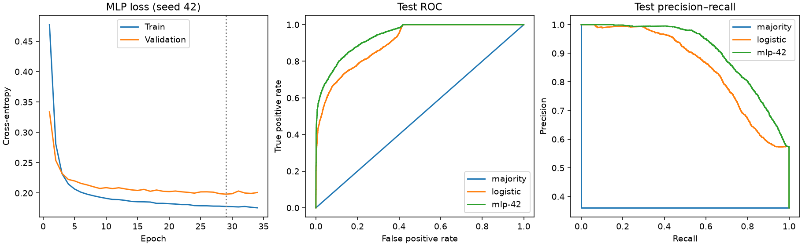

# Week 02 — Intrusion classifier

I compared three models on UNSW-NB15. After removing duplicate flows, I used 16,000 rows for training, 4,000 for validation and 10,000 for testing. I dropped the ID and attack category and fitted preprocessing on the training rows.

| Model | Precision at 0.5 | Recall at 0.5 | ROC-AUC | Test ROC TPR at ≤1% FPR |
|---|---:|---:|---:|---:|
| Majority class | 0.000 | 0.000 | 0.500 | 0.000 |
| Logistic regression | 0.574 | 0.947 | 0.902 | 0.424 |
| MLP, mean ± SD | 0.629 ± 0.012 | 0.948 ± 0.004 | 0.937 ± 0.004 | 0.556 ± 0.008 |

My MLP had 151 inputs, 64 ReLU units and two output classes. I used Adam, a batch size of 256, learning rates of 0.001 and 0.003, and seeds 7, 21 and 42. I kept the lowest validation-loss checkpoint, with patience 5 and a limit of 50 epochs.

For a deployment-style check, I picked each threshold on validation data with a 1% false-alarm budget and kept it fixed on the test set. With seed 42, validation FPR was 0.98%. On the test set the MLP caught 61.87% of attacks at 2.28% FPR. Logistic regression caught 46.26% at 1.66% FPR. Both went over budget. [Thresholds and results for every seed](evidence/summary.md)

The five largest logistic coefficients by magnitude were destination TTL (+6.12), destination load (−3.55), state CON (−3.37), SMTP service (+3.22) and source TCP window (−2.94). These weights describe associations in this sample. All flows came from UNSW-NB15. I would test the same thresholds on another network before using them for alerts.

Run `uv run python -m Week_02.intrusion` from the repo root. [Experiment settings](evidence/config.json) · [Results by seed](evidence/metrics.json) · [Training losses](evidence/sweep.csv) · [UNSW-NB15 dataset and papers, Moustafa & Slay](https://research.unsw.edu.au/projects/unsw-nb15-dataset)
