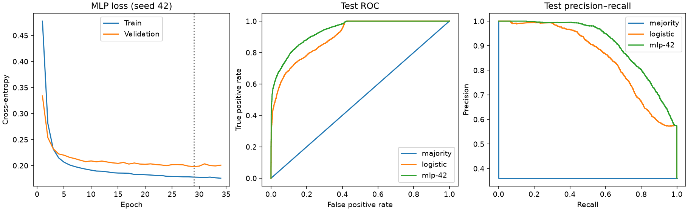

# UNSW-NB15 results

MLP: 151 inputs, 64 ReLU units, 2 output classes.

Each threshold was chosen on validation flows to maximize recall within the false-alarm budget. The last three columns use that same threshold on the held-out test set.

| Model | Threshold | Validation FPR | Test FPR | Test precision | Test recall |
|---|---:|---:|---:|---:|---:|
| majority | >1 | 0.00% | 0.00% | 0.00% | 0.00% |
| logistic | 0.909835 | 0.98% | 1.66% | 94.02% | 46.26% |
| mlp-7 | 0.934616 | 0.98% | 2.49% | 93.24% | 60.79% |
| mlp-21 | 0.929875 | 0.98% | 2.47% | 93.43% | 62.31% |
| mlp-42 | 0.931833 | 0.98% | 2.28% | 93.86% | 61.87% |

Largest logistic coefficients by absolute value (signed): numeric__dttl (+6.12), numeric__dload (-3.55), category__state_CON (-3.37), category__service_smtp (+3.22), numeric__swin (-2.94).

